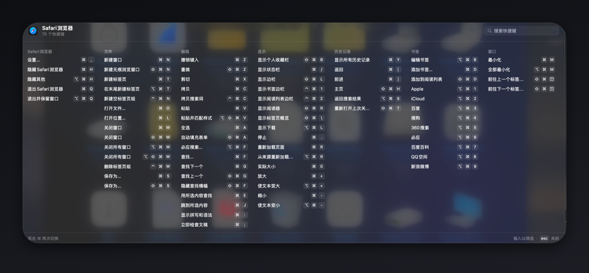

# 键览 KeyGlance

双击 ⌘，把当前 App 的全部快捷键铺在屏幕上。macOS 26（Tahoe）原生，Liquid Glass 面板。



## 下载

到 [Releases](https://github.com/liaooabc/KeyGlance/releases) 下载 `KeyGlance-1.0.0-arm64.zip`，解压后把 App 拖进「应用程序」。

首次打开请**右键 › 打开**（没有开发者签名，双击会被拦）。然后到「系统设置 › 隐私与安全性 › 辅助功能」勾选「键览」，否则读不到别的 App 的菜单。

## 用法

- 双击 ⌘ 唤出 / 收起；`esc` 关闭，面板外点一下也关
- 菜单栏的 ⌘：左键开关面板，右键出菜单（关于 / 设置 / 退出）
- 面板里直接打字搜索；第一列「常用」统计你最常按的组合
- 触发键可换成 ⌃ / ⌥ / ⇧，双击间隔也能调，都在设置里
- 「系统」分区列出调度中心、聚焦、截屏等系统级快捷键

## 要求

- macOS 26.0 及以上（面板用的是系统玻璃材质）
- Apple Silicon（arm64）
- 需要「辅助功能」权限：只读菜单，不记录任何输入

## 自己编译

```bash
./build.sh            # 输出 build/KeyGlance.app
./build.sh --install  # 并安装到 /Applications
```

## 许可

MIT。技术细节和实现笔记见 [docs/NOTES.md](docs/NOTES.md)。
